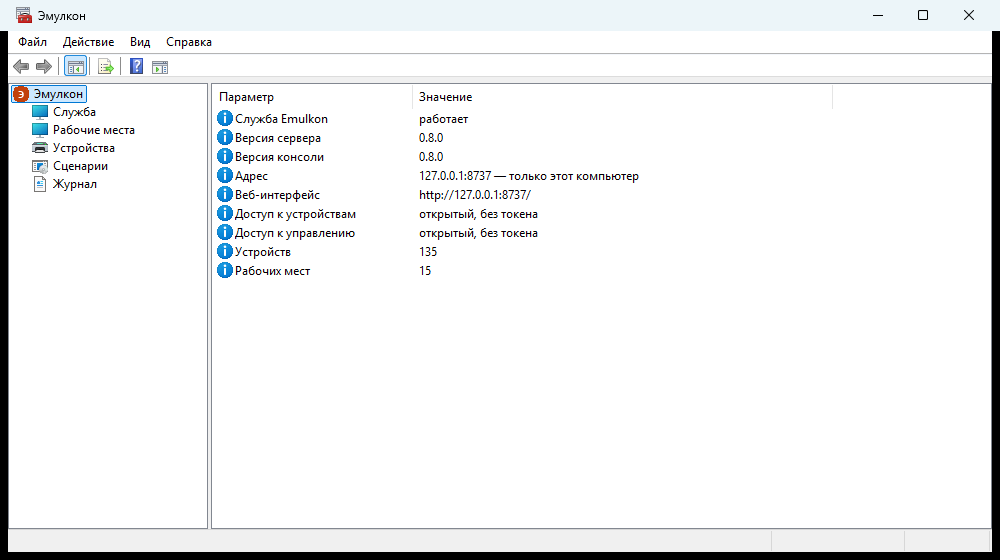
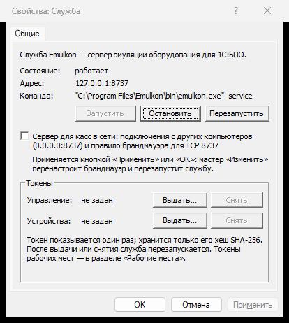
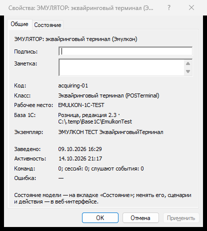
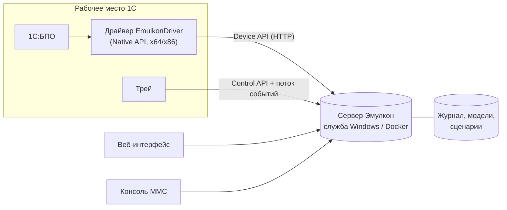

<p align="center">
  
</p>

<h1 align="center">Эмулкон</h1>

<p align="center">
  <b>Эмулятор подключаемого оборудования для 1С:БПО</b><br>
  ККТ, эквайринг, весы, принтеры, сканеры — без железа, для разработки и тестирования 1С
</p>

<p align="center">
  <a href="https://github.com/iMironRU/emulkon/actions/workflows/ci.yml"></a>
  <a href="https://github.com/iMironRU/emulkon/releases/latest"></a>
  <a href="LICENSE"></a>
  
  
</p>

**Сайт проекта: [imiron.ru/emulkon](https://imiron.ru/emulkon/)** — возможности, варианты использования, сравнение.

*Emulkon is a hardware emulator for 1C:Enterprise's Peripheral Equipment Library (BPO): fiscal registers, payment
terminals, scales, printers and scanners — a real Native API driver backed by an emulation server with fault
scenarios, an exchange journal, a web UI, a Windows tray app and an MMC console.*

---

Эмулкон подключается к «1С:Библиотеке подключаемого оборудования» **как настоящий драйвер** — один на все типы
оборудования — и передаёт вызовы на сервер эмуляции. На сервере живут модели устройств с проверками настоящего
железа, сценарии сбоев, журнал всех обменов и веб-интерфейс. Конфигурация 1С не меняется: тестируете то, что
уйдёт в работу.

> [!NOTE]
> Эмулкон узнаваем: «ЭМУЛЯТОР» в названии драйвера, в интерфейсе, на чеках и слипах. Он принимает только тестовые
> данные — реальные номера карт и ПИН не принимаются и не хранятся.

## Возможности

- **Все 12 типов оборудования требований к драйверам 4.8** на настоящих моделях: ККТ (ФН, смены, чеки и
  коррекции, маркировка, очередь ОФД), эквайринговый терминал, электронные весы и весы с печатью этикеток,
  принтеры чеков и этикеток, сканер штрихкода, считыватель карт, дисплей покупателя, ТСД, считыватель RFID,
  устройство распознавания.
- **Сценарии сбоев**: «нет бумаги на третьем чеке», задержки, обрыв связи, ответ после таймаута, смена состояния —
  включаются на лету, без перезапуска.
- **Журнал обменов**: каждая команда, ответ и событие, отбор и выгрузка в JSON Lines.
- **Веб-интерфейс**: устройства, их состояние и лента печати, рабочие места, сценарии, журнал вживую.
- **Трей у кассы**: всплывающие чеки и слипы, печать на принтер Windows, экран терминала «приложите карту» и весов.
- **Консоль MMC** в стиле Windows: служба, токены, рабочие места, устройства, сценарии, журнал.
- **Установщик** с «Изменить / Восстановить / Удалить», служба Windows, проверка работы вплоть до «Теста
  устройства» драйвером; **самообновление драйвера** в 1С.
- **Проверено на 11 конфигурациях 1С**: Розница 2.3 и 3.0, УНФ 3.0, РМК, УТ 10.3 и 11, КА 2, БП 3.0, БГУ 2.0
  ([tests/1c/RESULTS.md](tests/1c/RESULTS.md)).

## Как выглядит

<p align="center">
  
</p>
<p align="center">
  
  &nbsp;
  
</p>

## Быстрый старт

1. Скачайте `EmulkonSetup_<версия>.exe` со страницы [релизов](https://github.com/iMironRU/emulkon/releases/latest)
   и запустите (нужны права администратора). Контрольные суммы — `SHA256SUMS` в релизе.
   **Подписи кода пока нет**, поэтому:
   - SmartScreen может предупредить о неизвестном издателе — «Подробнее» → «Выполнить в любом случае»;
   - **антивирус (в т. ч. Microsoft Defender) может пометить установщик или забрать его в карантин** — это ложное
     срабатывание ([#20](https://github.com/iMironRU/emulkon/issues/20)): сравните файл с `SHA256SUMS`, восстановите
     из карантина и разрешите (в Защитнике: «Безопасность Windows» → «Защита от вирусов и угроз» → «Журнал защиты»).
     Срабатывание облачное и непостоянное — у кого-то его нет вовсе.
2. Установщик поставит сервер службой Windows, трей и драйвер для 1С и сам проверит, что всё работает.
3. В 1С: «Подключение и настройка оборудования» → «Драйверы оборудования» → «Добавить новый драйвер из файла»,
   файл — `C:\Program Files\Emulkon\1C\driver\EmulkonDriver_<версия>.zip`. Подробно — на странице загрузок
   сервера: **http://127.0.0.1:8737/downloads**.

Кассы в сети подключаются к одному серверу: «Пуск → Эмулкон — консоль → Служба → Свойства → Сервер для касс в
сети», токены — там же.

## Как устроено



Драйвер ничего не решает сам — «клиент глупый, сервер умный»: он знает только «метод, параметры, ответ,
событие». Повтор команды по `request_id` не выполняет её второй раз; команды одного устройства идут строго по
очереди.

| Документ | О чём |
|---|---|
| [ARCHITECTURE.md](ARCHITECTURE.md) | устройство целиком, решения, этапы |
| [docs/protocol.md](docs/protocol.md), [docs/openapi.yaml](docs/openapi.yaml) | Device API и Control API |
| [docs/models/](docs/models/) | поведение моделей: состояние, проверки, коды ошибок |
| [docs/bpo-requirements/](docs/bpo-requirements/README.md) | контракт БПО: методы и XML-структуры |
| [docs/local-install.md](docs/local-install.md) | установка, служба, консоль MMC |
| [component/](component/README.md), [tray/](tray/README.md), [console/](console/README.md), [setup/](setup/README.md) | драйвер, трей, консоль, установщик |

## Сервер без установки

Сервер кроссплатформенный (Go, без внешних зависимостей):

```bash
cd server
go run ./cmd/emulkon          # UI — http://127.0.0.1:8737
```

Docker — общий сервер для команды разработчиков, стенды и CI. Готовый образ с драйвером для касс внутри (страница
загрузок и самообновление драйверов работают):

```bash
docker run -d --name emulkon -p 8737:8737 -e EMULKON_DEVICE_TOKEN=… -e EMULKON_CONTROL_TOKEN=… \
  -v emulkon-data:/data ghcr.io/imironru/emulkon:latest
```

Каждый разработчик подключает драйвер в своей 1С к адресу сервера: рабочие места и устройства различаются сами
(по компьютеру и базе), журнал и сценарии — общие, доступ — по токенам. Сборка образа из исходников —
`docker build -f deploy/docker/Dockerfile -t emulkon:dev .` (драйвер — в `deploy/docker/downloads/`), compose —
[deploy/docker/compose.yaml](deploy/docker/compose.yaml). Linux без Docker — пакеты `.deb`/`.rpm`
([deploy/linux](deploy/linux/README.md)).

<details>
<summary>Настройки сервера</summary>

Порядок: ключи `-addr`, `-data`, `-downloads` → переменные окружения → реестр Windows
(`HKLM\SOFTWARE\Policies\Emulkon`, затем `HKLM\SOFTWARE\Emulkon\Server`; [docs/local-install.md §2.1](docs/local-install.md))
→ значения по умолчанию. Токены можно задать хешем SHA-256: `EMULKON_DEVICE_TOKEN_HASH`,
`EMULKON_CONTROL_TOKEN_HASH`. Ключ `-service` — запуск службой Windows (её регистрирует установщик).

| Переменная | По умолчанию | Назначение |
|---|---|---|
| `EMULKON_ADDR` | `127.0.0.1:8737` | адрес HTTP |
| `EMULKON_DATA_DIR` | `data` | каталог данных |
| `EMULKON_DOWNLOADS_DIR` | рядом с программой | каталоги дистрибутива для `/downloads` через `;` |
| `EMULKON_DEVICE_TOKEN` | — | общий токен устройств; пусто — принимается любой |
| `EMULKON_CONTROL_TOKEN` | — | токен Control API и UI; пусто — без авторизации |
| `EMULKON_DEFAULT_TIMEOUT_MS` | `30000` | рекомендуемый таймаут драйвера |
| `EMULKON_JOURNAL_MAX_FILE_MB` | `32` | порог ротации файла журнала |
| `EMULKON_JOURNAL_MAX_FILES` | `8` | сколько файлов журнала хранить |
| `EMULKON_SESSION_IDLE_TTL` | `24h` | жизнь простаивающей сессии |
| `EMULKON_LOG_LEVEL` | `info` | `debug`, `info`, `warn`, `error` |
| `EMULKON_UPDATE_MODE` | `notify` | новые выпуски: `off` или `notify` — раз в сутки; служба Windows скачивает установщик, ставит человек (трей, консоль) |
| `EMULKON_UPDATE_URL` | выпуски GitHub | свой `latest.json` |

Без токенов сервер предназначен только для локальной работы: при прослушивании не-localhost он предупреждает в
логе, UI показывает плашку.

</details>

<details>
<summary>Попробовать без 1С — curl</summary>

```bash
# открыть сессию, как драйвер ККТ
curl -s -X POST http://127.0.0.1:8737/api/v1/sessions \
  -H "Content-Type: application/json" \
  -d '{"workstation_id":"KASSA-01","equipment_type":"KKT","interface_revision":4008}'
# → {"session_id":"s_…","device_id":"kkt-01",…}

# вызвать метод
curl -s -X POST http://127.0.0.1:8737/api/v1/devices/kkt-01/commands \
  -H "Content-Type: application/json" -H "X-Emulkon-Session: s_…" \
  -d '{"request_id":"r-1","method":"PrintXReport","params":["h1","<InputParameters/>"]}'
```

В UI на вкладке «Журнал» появятся `session.open`, команда и ответ.

</details>

## Сборка из исходников

| Часть | Язык | Сборка |
|---|---|---|
| сервер | Go 1.24+ | `cd server && go build ./... && go vet ./... && go test ./...` |
| драйвер, трей, консоль, установщик | C++17, clang-cl (ABI MSVC), CMake + Ninja | `.\build.ps1` в корне — всё сразу в `dist\` |

- **Тулчейн C++** — clang-cl из LLVM с библиотеками MSVC и Windows SDK; toolchain-файлы CMake — каталог из
  переменной `DEV_CMAKE_TOOLCHAINS`. В CI — [cmake/toolchains](cmake/toolchains) (Visual Studio и LLVM раннера).
- **SDK Native API 1С** (`ComponentBase.h` и др.) в репозиторий не входит — он распространяется 1С. Путь к его
  каталогу `include` — переменная `ONEC_SDK` или `-DONEC_SDK=…` ([component/README.md](component/README.md)).
- Версия одна на всё — файл [VERSION](VERSION). Сборка по тегу `v*` публикует релиз с установщиком и драйвером.

## Участие

Ошибки и предложения — в [Issues](https://github.com/iMironRU/emulkon/issues), правила — в
[CONTRIBUTING.md](CONTRIBUTING.md), уязвимости — по [SECURITY.md](SECURITY.md). История версий —
[CHANGELOG.md](CHANGELOG.md).

## Лицензия

[Apache License 2.0](LICENSE). «1С», «1С:Предприятие» и названия конфигураций — товарные знаки ООО «1С»;
Эмулкон с 1С не связан.
